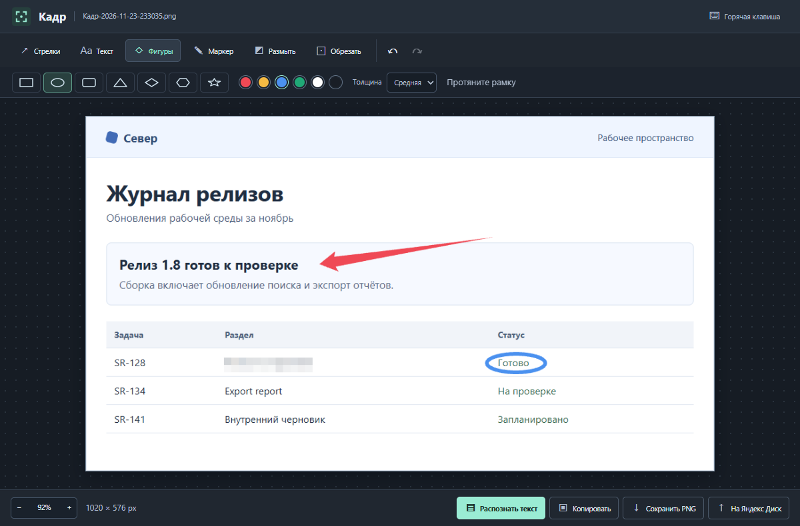

# Shotmark

[Русский](#русский) · [English](#english)

## Русский

Shotmark («Кадр») — расширение для Chromium. Оно снимает выбранную область вкладки, позволяет разметить снимок и распознаёт русский и английский текст локально.

### Установка

1. Скачайте ZIP расширения из [релизов GitHub](https://github.com/tchme/shotmark/releases) и распакуйте архив.
2. Откройте `chrome://extensions` и включите режим разработчика.
3. Нажмите **Загрузить распакованное расширение** и выберите папку с `manifest.json`.
4. Нажмите иконку расширения или `Alt+Shift+S`, чтобы выделить область. Сочетание можно изменить на `chrome://extensions/shortcuts`.

### Снимки и распознавание

- Добавляйте стрелки, фигуры, маркер и подписи прямо на снимке. Выделите область в режиме **Текст**. `Enter` добавляет строку, `Ctrl+Enter` применяет подпись, `Esc` отменяет ввод.
- Скрывайте участки мозаикой, мягким размытием или сплошной замазкой. Для конфиденциальных данных используйте сплошную замазку. `Ctrl+Z` отменяет правку, `Ctrl+Shift+Z` возвращает её.
- Кнопка **Распознать текст** позволяет выделять символы прямо на снимке. Для готовой картинки на сайте используйте **ПКМ → Распознать текст на картинке**. `Ctrl+C` копирует выделение, **Копировать весь текст** — весь результат. `Esc` убирает слой распознавания на странице.
- **Копировать** и **Сохранить PNG** закрывают редактор после успешного экспорта.

### Яндекс Диск

Кнопка **На Яндекс Диск** загружает отредактированный PNG и создаёт публичную ссылку. Клик по уведомлению открывает снимок. Ссылку также можно открыть или скопировать из карточки в редакторе. Если Яндекс попросит войти, завершите вход и снова нажмите **На Яндекс Диск**. Снимок останется в редакторе.

### Разработка и лицензия

Инструкции по запуску браузерных тестов есть в [документации для разработчиков](docs/development.md). Код расширения распространяется по [лицензии MIT](LICENSE). Для включённых компонентов Tesseract действуют их собственные лицензии.

## English

Shotmark is a Chromium extension for capturing and annotating part of a tab and selecting text from screenshots or web images. The browser displays it as **Кадр**. OCR runs locally and supports Russian and English. The optional Yandex Disk action uploads the edited PNG and creates a public link.

### Install

1. Download and extract the extension ZIP from [GitHub Releases](https://github.com/tchme/shotmark/releases), or clone this repository.
2. Open `chrome://extensions` and turn on Developer mode.
3. Choose **Load unpacked** and select the extracted directory containing `manifest.json`.
4. Click the extension icon or use **Alt+Shift+S** to start selecting a region. Set a different supported shortcut at `chrome://extensions/shortcuts`.

On browser pages that block injection, select the region in the editor after the visible tab opens there, provided Chromium permits the capture. Press Escape to cancel selection on an ordinary webpage.

### Edit and recognize

Choose an arrow or shape using its icon, then drag to draw it. The editor starts with the tapered arrow, which widens from its tail toward its tip. Shape icons cover the rectangle, ellipse, rounded rectangle, triangle, diamond, hexagon and star. The marker also uses drag gestures. To add a label, drag a text box or click the image and type directly on it. Press Enter for a new line, Ctrl+Enter to apply, or Esc to discard the draft. Clicking outside the box applies it.

The blur tool starts in mosaic mode with three block sizes. It also offers soft blur and an opaque mask. Use the opaque mask for information that should not be present in the exported image. Undo and redo with the toolbar or Ctrl+Z / Ctrl+Shift+Z. The editor closes after the image is copied or the PNG download completes. It stays open if either action fails or the download is cancelled.

**Распознать текст** highlights recognized Russian and English lines over the edited image. Drag to select individual characters or a passage, or double-click a word. Press Ctrl+C to copy the selection. Use **Копировать весь текст** to copy everything. **Править текст** allows corrections to the text used by the copy-all button. Further image edits clear the recognition result.

To recognize an existing web image, right-click it and choose **Распознать текст на картинке**. Kadr highlights selectable characters directly over the image in the current tab. Copy a selection with Ctrl+C, use **Копировать весь текст** for the entire result, or dismiss the layer with Esc. For top-level images that the browser protects from direct pixel reads, Kadr works with the visible part of the image in the tab. If the browser blocks access to the page or frame, use region capture and the editor's OCR button.

### Save to Yandex Disk

Click **На Яндекс Диск** to upload the edited PNG to the Disk root and publish a link to that file. Anyone with the link can view it. Click the system notification to open the Yandex Disk viewer, or use the result card in the editor to open or copy the link and close the editor after the action succeeds.

Kadr uses the Yandex account already signed in to the current Chromium profile. If Disk redirects to sign-in, click the sign-in notification or the editor card, complete sign-in in the official Yandex window and press **На Яндекс Диск** again. The editor stays open throughout. Chromium may request permission to access `disk.yandex.ru` on installation or update.

### OCR components

The `ocr` directory includes Tesseract.js 7.0.0, the Tesseract.js Core 7.0.0 LSTM browser runtimes, and the English and Russian `4.0.0_best_int` trained-data files from `@tesseract.js-data/eng` and `@tesseract.js-data/rus` 1.0.0. Third-party notices are included alongside these components.

### Development and license

See [Development](docs/development.md) for the browser test setup. The extension code is available under the [MIT License](LICENSE). Bundled OCR components retain their accompanying licenses.
